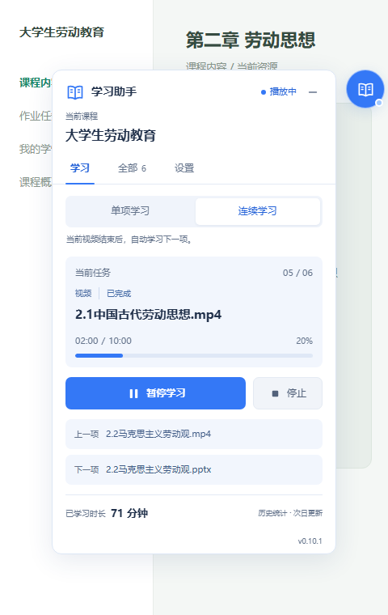
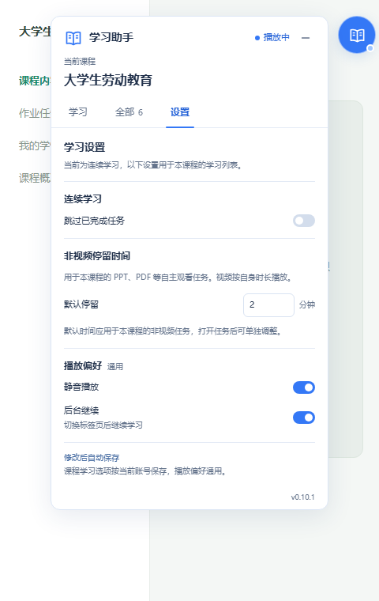

# 小雅视频连播助手

面向武汉理工大学小雅学习平台的浏览器用户脚本，提供视频连播、非视频自主观看任务计时、课程任务列表和学习状态查看。

**当前版本：0.10.1** · [脚本文件](./xiaoya-video.user.js) · [脚本猫发布页（待补充）][scriptcat-release] · [详细使用说明](./使用说明.md)

## 界面预览

| 学习首页 | 学习设置 |
| --- | --- |
|  |  |

截图使用本地演示数据，不包含真实账号信息。

## 功能

- **单项与连续学习**：在首页直接切换。单项结束后停止；连续模式按课程顺序学习下一项。
- **视频自动切换**：视频自然播放结束后等待 5 秒，再进入下一项。
- **非视频停留计时**：支持带“自主观看”标记的 PPT、PDF 等任务，默认停留 2 分钟，可设置课程默认时间和单项时间。
- **任务列表**：进入课程即检测列表，支持搜索、完成状态筛选、定位当前任务和点击跳转。
- **相邻任务长条**：直接显示上一项、下一项名称，整条可点击，在当前标签页切换。
- **按需显示设置**：根据学习模式和任务类型隐藏不适用的配置，保留原设置值。
- **后台继续与静音**：保留切换标签页前的播放意图，支持恢复平台因页面隐藏而暂停的视频。
- **未操作提示处理**：识别平台的“继续学习”弹窗，确认后恢复学习。
- **平台状态与历史时长**：读取任务完成记录和课程历史学习时长，区分本次播放进度与平台完成状态。
- **本地缓存**：缓存课程目录、完成状态与历史时长，减少重复读取。

## 适用范围

| 页面 | 地址范围 |
| --- | --- |
| 小雅首页与课程页面 | `https://whut.ai-augmented.com/*` |
| 统一登录页 | `https://infra.ai-augmented.com/app/auth/*` |

当前适配上述站点的页面结构与播放器。其他学校或域名未验证，修改匹配规则后也可能需要调整页面选择器和接口。

## 安装

脚本可直接安装到 ScriptCat（脚本猫）或 Tampermonkey 用户脚本管理器，使用时不需要 Node.js 或构建步骤。

[前往脚本猫（发布链接待补充）][scriptcat-release]。当前入口指向脚本猫首页，本项目发布地址补充前，可按下面的步骤手动安装。

1. 在浏览器中安装并启用用户脚本管理器。
2. 打开本仓库的 [xiaoya-video.user.js](./xiaoya-video.user.js)，复制全部代码，包含开头的 `==UserScript==` 元数据。
3. 在管理器中新建脚本，替换默认内容，保存并启用。
4. 打开或刷新小雅页面。未登录时显示“请先登录”；登录后进入课程即可自动检测任务列表。

**更新已有脚本：**在管理器中编辑原脚本，用新版完整内容替换并保存，然后刷新已打开的课程页。保持一个启用的版本；面板底部应显示 `v0.10.1`。

目前使用手动更新方式。仅保存编辑器内容，不会替换已经在课程页运行的旧代码。

## 使用

1. 点击页面上的蓝色书本悬浮按钮，展开助手；拖动按钮或面板标题可移动位置。
2. 在 **学习** 页选择“单项学习”或“连续学习”。单项模式需先打开具体任务；连续模式可从当前任务开始，也可从课程概览页启动。
3. 点击主按钮开始、暂停或继续学习。右侧“停止”结束本次运行。
4. 点击上一项／下一项的任务长条，或在 **全部** 页点击任务名称，即可在当前标签页打开对应任务。
5. 进入顶部 **设置** 页调整适用选项；修改后自动保存。

切换助手页签不会暂停学习。页签支持左右方向键切换，按 `Esc` 收起面板。

### 学习模式

| 模式 | 结束行为 | 显示的设置 |
| --- | --- | --- |
| 单项视频 | 当前视频结束后停止 | 静音、后台继续 |
| 单项非视频 | 当前任务达到计划停留时间后停止 | 本项停留、后台继续 |
| 连续学习 | 当前项结束后按顺序继续，最后一项结束后停止 | 跳过已完成，以及课程任务类型适用的停留和播放选项 |

连续模式下，课程包含非视频任务时才显示默认停留时间，包含视频时才显示静音。单项模式隐藏“跳过已完成”。隐藏配置不会清空原值。

### 非视频停留时间

- 仅用于带“自主观看”标记的非视频任务，普通课件不自动加入列表。视频按自身时长播放。
- 初始为 **2 分钟**，支持 **2～1440 的整数分钟数**。
- 单项时间优先于课程默认；留空或点击“使用课程默认”可恢复继承。
- 修改计划时间保留本页已累计的停留时间；刷新或重新进入该任务后重新计时。
- 预览未就绪、预览失败、暂停、弹窗阻塞或离开任务页面时不计时。

### 完成状态与历史时长

**播放结束或停留计时结束，仅决定是否切换任务，不代表平台已认定任务完成。**

- 完成状态读取平台任务记录或已记录的观看进度，未知或读取失败时不会按已完成处理。
- “跳过已完成任务”仅影响连续学习的自动选择，手动切换仍可回看已完成任务。
- “已学习时长”是平台的历史统计，**次日更新**，不会把本次视频时间或停留时间实时加进去。
- 是否累计学习时长、是否满足任务条件，以平台“我的学情”和任务记录为准。

## 数据与缓存

脚本使用当前页面的登录态读取平台接口，操作页面已有播放器，不包含独立学习记录提交或自动提交任务的功能。配置和缓存保存在浏览器本地，登录令牌不写入缓存。

| 内容 | 保存方式 |
| --- | --- |
| 学习模式、跳过已完成、停留时间 | 按当前账号与课程保存 |
| 静音、后台继续、悬浮位置 | 通用偏好 |
| 课程目录 | 缓存 10 分钟 |
| 完成状态 | 缓存 30 秒 |
| 历史学习时长 | 缓存 15 分钟 |

在“全部”页点击刷新按钮，可重新读取课程、列表、完成状态和历史时长。

## 常见问题

### 安装或更新后没有变化

确认管理器已启用脚本，并刷新课程页面。查看面板底部版本号，确认页面实际运行的是新版。未登录时，确认脚本包含统一登录页的匹配规则。

### 浏览器提示不能自动播放

手动点击一次页面的视频播放按钮，再使用助手继续。脚本会显示需要手动操作的提示。

### 切换页面后停止了

切到其他浏览器标签页时，可通过“后台继续”恢复播放。在播放所在标签页内跳到作业、课程概览或学情等非任务页面，会卸载播放器并停止本次学习。

浏览器冻结标签页、电脑休眠或网络中断时，播放和定时切换也可能暂停或延迟。

### 计时已结束，但任务仍未完成

计时和平台任务完成状态分别显示。需要提交的任务仍需按平台要求手动完成；“待检测／检测失败”也不代表已完成。

### 平台更新后功能异常

本脚本依赖页面结构、播放器事件和平台接口。反馈问题时，请附上脚本版本、浏览器与脚本管理器、操作步骤，以及不含账号或登录信息的截图或错误信息。

## 开发与验证

脚本为单文件 JavaScript，无构建步骤。本地验证使用 Node.js 24，开发依赖通过 `.tools/package-lock.json` 锁定。

```sh
# 安装本地测试依赖，不影响脚本的浏览器安装
npm ci --prefix .tools

# 语法检查
node --check xiaoya-video.user.js

# DOM 与业务行为回归检查
node --test tests/verify.cjs

# 生成本地静态界面预览
node tests/preview.cjs

# 使用 Chrome 检查真实浏览器导航
node tests/navigation.cjs
```

浏览器导航测试默认使用 Windows 的 Chrome 安装路径；其他环境可通过 `CHROME_PATH` 环境变量指定浏览器可执行文件。测试使用隔离配置和本地模拟课程，不连接真实学习账号。

当前版本通过 **49 项本地回归检查**及 **6 种浏览器点击场景检查**，覆盖同标签页跳转、往返后的延迟就绪、模式切换、设置显示和配置保留等。测试使用模拟环境，不能替代真实平台上的完成记录验证。

测试夹具使用 `tests/platform-visibility.js` 中保存的平台页面隐藏处理片段。更多实现核对见 [详细使用说明](./使用说明.md)。

## 目录

```text
xiaoya-video.user.js     用户脚本
README.md               仓库首页
使用说明.md             详细说明与实现核对
脚本猫介绍.md           可粘贴到脚本猫发布页的介绍文案
docs/images/            README 演示截图
tests/                  平台处理片段、DOM、浏览器导航与预览工具
.tools/package*.json    测试依赖清单与锁文件
design/                 本地界面设计参考（未上传）
preview/                本地生成的预览，不需要上传
```

## 致谢

感谢 [zygame1314](https://blog.zygame1314.site/) 在小雅相关工具上的分享，为本项目的功能设计和使用体验提供了参考。

欢迎访问作者的 [个人主页与博客](https://blog.zygame1314.site/)，了解其作品与更新。

<!-- 发布到脚本猫后，只需将下面的地址替换为本项目的脚本发布页，正文中的入口会同时更新。 -->
[scriptcat-release]: https://scriptcat.org/
